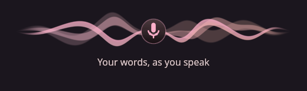

# Caelestia Voice Typing

Offline dictation for Hyprland, integrated into the Nexus settings and overlay system of [MiDnight Shell](https://github.com/dim-ghub/midnight-shell), a fork of [Caelestia Shell](https://github.com/caelestia-dots/shell).

Press **Ctrl + Super + V** to dictate into the focused text field. The overlay previews partial speech, and agreed text is inserted as recognition progresses. Press the shortcut again or **Esc** to finish. Dictation runs locally with PipeWire and faster-whisper. The add-on includes **Dynamic Wave**, **Classic**, and **Compact** themes.



## Styling and animation

| File | What to edit |
| --- | --- |
| [VoiceTypingWave.qml](modules/voicetyping/VoiceTypingWave.qml) | Dynamic Wave microphone, caption, audio smoothing, and animation timing |
| [dynamic-wave-ribbons.frag](modules/voicetyping/dynamic-wave-ribbons.frag) | Wave shape, Matugen color blending, and processing and success rings |
| [VoiceTypingOverlay.qml](modules/voicetyping/VoiceTypingOverlay.qml) | Position, scale, and widget entrance, exit, and theme transitions |
| [themes/](modules/voicetyping/themes/) and [ThemeRegistry.qml](modules/voicetyping/ThemeRegistry.qml) | Theme layouts, names, and registration |

Open **Nexus → Services → Voice Typing → Appearance / Theme** to preview the actual theme components with sample data. You can use these previews before downloading a speech model. For live wave motion, start dictation and speak into the selected microphone.

After changing the GLSL, rebuild the Qt shader package with Qt 6's `qsb` and restart the shell to clear the shader cache. The shader source and its compiled asset both belong in the repository.

```sh
cd modules/voicetyping
/usr/lib/qt6/bin/qsb --qt6 -o dynamic-wave-ribbons.frag.qsb dynamic-wave-ribbons.frag
```

## Install

Start with a working [MiDnight Shell](https://github.com/dim-ghub/midnight-shell/tree/f4ade958) installation, including its Caelestia QML modules, and a Hyprland session using Lua configuration. The installer expects MiDnight's Nexus and lock-screen components. Stock Caelestia compatibility has not been verified.

Clone this repository and run the installer against a user-owned shell configuration. If your shell is installed system-wide, copy its configuration into your user configuration directory first. Run `python3 install.py --dry-run` to see the files that would change.

```sh
git clone https://github.com/DevMagician543/caelestia-voice-typing.git
cd caelestia-voice-typing
python3 install.py
```

The installer defaults to `${XDG_CONFIG_HOME:-$HOME/.config}/quickshell/caelestia`. Pass `--shell-dir PATH` for a different location. It backs up changed files under `${XDG_STATE_HOME:-$HOME/.local/state}/caelestia/voice-typing-backups`. Run it again after changing a theme in the repository to copy your edits into the shell configuration.

Restart your shell using its normal launcher. If you launch the named configuration directly with Quickshell, the commands are `qs kill -c caelestia` and `qs -c caelestia -n -d`. On shells that provide the `appearance reloadShell` IPC method, you can use it after QML-only edits.

Set up the local transcriber under **Nexus → Services → Voice Typing → Install selected model**. The [setup and architecture guide](scripts/voice-typing/README.md) lists the PipeWire and build dependencies and explains model selection, GPU fallback, and text insertion.

If Hyprland adds its own animation to the overlay, add this rule to your user Lua configuration and reload Hyprland so the QML animation runs on its own.

```lua
hl.layer_rule({ match = { namespace = "caelestia-voice-typing" }, no_anim = true })
```

## License

[GNU GPL v3](LICENSE). The vendored [Wayland virtual keyboard protocol](scripts/voice-typing/virtual-keyboard-unstable-v1.xml) retains its original copyright and permission notice.
